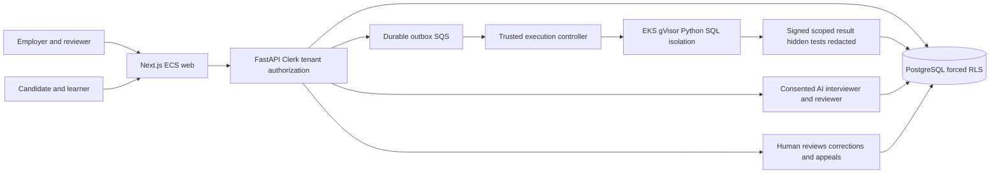

# SkillForge — Four-wave Roadmap + REA implementation contract

**Baseline:** 2026-10-28, PR #70 at bfc4cbdeaed3bc71cbd3aa9225ccbf4af8883976  
**Canonical repo:** rrahul0904/leetcode-platform (existing codebase, no duplicate repo)  
**Current state:** BUILDING; **PRODUCTION NO-GO**.  
**Production hosting:** Customer-authorized AWS (not Railway, Render or Vercel).  
**Prior projects:** #55 original SkillForge V1, #71 employer extension, PR #70; both release programs must be reconciled.

## Governed REA evidence and clean-room boundaries

- E-01 OBSERVED: PR #70 source implements tenant-aware employer assessment authoring, candidate invitations, autosave, timed submissions, human reviews and consent-based text interview. It remains draft/unmerged.
- E-02 OBSERVED: apps/web/components/assessment-coding-pads.tsx explicitly saves Python/SQL answers but does **not** connect employer Run, Submit or hidden tests.
- E-03 OBSERVED: docs/platform/SKILLFORGE_LAUNCH_ACCEPTANCE.md defines L01-L10 P0 gates; all currently NO-GO.
- E-04 OBSERVED: GitHub Actions on baseline SHA: full CI 40630606777, Python 40630606778, security 40630606829, browser smoke 40630606771, Terraform 40630606871, migration 40630606817 and web container 40630606806 all succeeded. These are **not** a real AWS production or two-account UAT certificate.
- E-05 OBSERVED: 17 user-provided Level-4 sets, 252 questions (112 DE, 140 DevOps), offline staged and NOT approved for public redistribution. Source guides, keys and confidential cases must remain private.
- E-06 OBSERVED: historical #55 15-gate Vercel contract remains blocked. Retain as history; AWS contract below controls new release.
- E-07 RESEARCHED: https://support.hackerrank.com/articles/3245197419-test-cases-in-coding-questions documents sample/hidden test separation and deterministic evaluation. Behavioral reference only.
- E-08 RESEARCHED: https://support.codesignal.com/hc/en-us/articles/22112130416535-Quick-Start-Guide-Assessments documents candidate IDE, assessment and optional proctoring. Behavioral reference only.
- E-09 UNKNOWN: provisioned AWS accounts/roles, domains, protected secrets, authoritative content rights, real model provider, backup/restore and multi-account live UAT.
- REA_PROVIDER_UNAVAILABLE: REA-specific automation not connected. Manual authorized research and GitHub source inspection were performed instead; no claim of full provider execution.

Do not copy competitor code, assets or questions. Keep the original SkillForge product and existing identity, catalog and execution services. No additional shipping repository.

## Target architecture

No untrusted code may run inside API/web. Hidden cases/keys must never reach client responses, public bundles or AI prompts. Every attempt and result is bound to organization, candidate, immutable assessment version, question, source and test fixture hashes. Human review, not AI, controls final hiring outcomes.

## W1 — Source reconciliation, freeze, and security (BUILDING)

**Implement:** one canonical AWS release record linked to #55/#71; current architecture and rights register; deterministic fail-closed ten-gate evidence validator with negative tests; CI contract check; isolate production advertising from unimplemented AI-pad or proctoring. Keep development on draft PR #70.

**Acceptance:** baseline blocks deployment claims; tests reject missing gates, wrong SHA, fabricated reviewer approval, untrusted URLs and unsupported hosting; exact SHA CI passes; scope/rights and critical defects are attributed to owners.

## W2 — Real Python/SQL assessment execution (BLOCKED)

**Implement:** immutable, privately approved test-bundle schema; independent original runnable Python and PostgreSQL questions with sample and hidden cases; authenticated candidate Run/Submit endpoints with idempotency, server deadlines and tenant boundaries; durable SQS -> trusted controller -> EKS/gVisor; redacted candidate results and auditable scoring receipts. Employer authoring must require real rubric/fixtures before claiming a runnable code question. Distinguish employer-scored execution from learner practice; never reuse learner endpoints with weaker authorization.

**Acceptance:** real browser -> API -> durable queue -> gVisor -> result -> DB -> browser for both languages; independent valid/incorrect/mutant submissions and adversarial timeout, memory, filesystem, metadata/network escape, concurrency, replay and cross-account tests; exact fixture hash proof. Satisfies L01, L02, L04 only after rights approved.

## W3 — Human-centered AI, integrity, and complete user journeys (BLOCKED)

**Implement:** two employer organizations and two candidate real accounts; invitations, expiry/revoke, email, accommodations, autosave/recovery and accessible submission; true provider-backed opt-in text interviewer, policy-controlled AI help, evidence-linked advisory AI reviewer with human override; reporting/correction/appeal. For advertised integrity checks require transparent candidate notice, scoped collection, retention controls and human investigation. Optional video/live collaboration must be consent- and access-controlled, never facial/emotion-based automated rejection.

**Acceptance:** independent 2-org/2-candidate deployed E2E, negative RLS/privacy cases, real AI provider errors and prompt-injection red-team, model-version evidence, multiple reviewers, assistive tech/mobile keyboard UAT, candidate appeal and email delivery. Complete L05, L06, L08; L07 either verified if marketed or not advertised at launch.

## W4 — AWS production and independent launch certificate (BLOCKED)

**Implement:** customer-owned remote Terraform state and protected GitHub OIDC roles; ECS web/API/workers, Aurora/Postgres, SQS/DLQ, gVisor execution nodes, TLS/ACM/Route53, WAF, Clerk live auth, secrets, telemetry; backup/PITR restore, migration rehearsals, hostile-runner/load/accessibility/security review, incident/rollback practice; exact-SHA build and explicit owner-controlled promotion.

**Acceptance:** independent exact SHA/image-digest CI, actual AWS endpoints and production user journeys, privacy/security/rights signoff, DB restore and rollback receipts, no critical vulnerabilities, monitoring and post-deploy verification. Complete L03, L09, L10 after all earlier gates. NO automatic merge, publication or production cutover.

## Four supervisors and release loop

Release Owner (scope/approval), REA Owner (evidence and rights), Implementation Owner (architecture, web/API, runner, infra), Independent QA Owner (security, test, UX and operational replay). Specialists operate under these owners; these roles do **not** imply active spawned agents. For each failure: record repro -> fix minimum slice -> rerun original test + regression -> independent verdict -> exact-SHA evidence. Never replace unverified proof with a percentage.

## Authoritative acceptance

The ten gates map to four waves in docs/platform/skillforge_four_wave_gate_status.json. scripts/skillforge_four_wave_gate.py validates the ledger and refuses to certify unproven gates. Its verification checks receipt structure, **not evidence truth**; independent reviewers must confirm live links, AWS, rights and tests. The canonical source acceptance document remains docs/platform/SKILLFORGE_LAUNCH_ACCEPTANCE.md. Any conflict is a NO-GO until reconciled.

Release stage: RESEARCHED -> SPECIFIED -> BUILDING -> RUNNABLE -> UAT PASS -> PRODUCTION VERIFIED -> SHIPPED. Do not claim SHIPPED from a prototype, test fixture, CI, Terraform validation or passing Preview alone.
