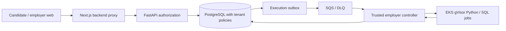

# SkillForge implementation status

**Audit:** 2026-10-29. **Repository:** `rrahul0904/leetcode-platform`.
**Main:** `2e785369d97c387932931e1954b1b715183b5784`.
**Draft PR #70 baseline:** `c35aee9b27d35aa2060aa93568c47f3eb29c541f`.
**Verdict:** BUILDING; PRODUCTION NO-GO. The final pushed SHA and CI state must be checked after this change lands.

## Scope and provenance

PR #70 contains the employer extension and is unmerged. Main has the learner platform and PR #46, which merged on 2026-10-02. PR #66 remains an open, uncertified hosted V1 candidate. Draft PRs #53, #68 and #69 contain donor experiments and are not release stock. The July `IMPLEMENTATION_PROGRESS.md` snapshot is historical. The original 1,350-question manifest is a planning benchmark. The 252 Level-4 DE/DevOps items remain offline staged and rights review is outstanding.

The historical 15-gate Vercel program in issue #55 and the open PR #66 remains an audit trail, including its failed or unproven Preview and production gates. The AWS L01-L10 contract in issue #73 and `SKILLFORGE_LAUNCH_ACCEPTANCE.md` governs future launch. No historical gate is silently converted to an AWS pass. Existing Vercel workflows and documents are provenance only; production hosting is AWS.

| Historical #55 gate group (all blocked in PR #66 ledger) | Current AWS acceptance relationship |
| --- | --- |
| `source_ci`, `preview_identity`, `preview_http` | Source CI is a prerequisite for L10; Vercel Preview identity/HTTP are historical and cannot prove AWS L03 |
| `hosted_clerk_journey`, `two_account_rls` | L03 and L05 require new AWS identity, DB and tenant receipts |
| `reviewed_content_catalog` | L04 requires new rights and publication approval |
| `python_run_submit`, `sql_run_submit`, `adversarial_execution` | L01 and L02 require real AWS isolated execution and abuse proof |
| `candidate_browser_uat`, `admin_browser_uat`, `mobile_accessibility` | L05 and L08 require real hosted multiperson and accessibility UAT |
| `backup_restore`, `staged_production`, `production_postpromotion` | L09 and L10 require AWS restore, rollback, approval and same-build promotion |

## Architecture and route map

Source-defined endpoints include `/api/v1/employer/organizations`, `/api/v1/employer/assessments`, `/api/v1/assessment-invitations/accept`, `/api/v1/assessment-attempts/{id}/responses`, `/submit`, `/code-executions`, and `/api/v1/employer/attempts/{id}/code-executions`. Web routes include `/employer`, `/employer/assessments`, `/employer/reviews`, and `/assessments`. These are draft branch code, not live production endpoints.

## Current Wave 2 slice

Typed Python and SQL bundle validation, private version-bound fixtures, candidate Run/final Submit, source snapshots, SQS outbox, worker comparison and redacted candidate results were already in PR #70. This slice adds fixture SHA, runner image SHA, SQL PostgreSQL image SHA and result SHA to the terminal database row, forbids terminal row updates, requires digest-pinned employer runtime images, and stages the separate employer controller with its own queue. It also grants the app role the membership read needed by employer RLS policies. The local PostgreSQL test uses a simulated sandbox; it does not establish hostile-code isolation.

## Open architectural and security findings

- `organizations` and `organization_memberships` were created without forced RLS. Application routes check memberships, but a dedicated database policy and role/transaction test across those two tables is still needed before tenant security can be certified. The worker role has broad cross-tenant read policies by design; its credential, network and audit boundaries need independent review.
- Employer Run is queued even if the cloud execution plane is unavailable. The UI reports a queued job; it has no server capability probe to disable Run when the plane is absent. This must be corrected before hosted UAT.
- Runner image digests and result hashes are now stored for successful terminal results, but no signed artifact attestation or independent cloud runtime proof exists. The scoring comparison is in the trusted controller; the sandbox interface is mocked in the local employer test.
- Invitations use secure one-time tokens with manual handoff; transactional email delivery, accommodations, AI reviewer, live collaboration, and integrity appeals are incomplete or disabled.
- AWS account, remote state, protected OIDC, production domains, Clerk issuer, backups/PITR, load, rollback and human signoffs have not been verified. Do not infer them from Terraform or CI.

## Immediate engineering queue

1. Finish employer execution availability fencing and the actual EKS/gVisor staging replay for Python and SQL, including negative abuse cases. Owner: implementation engineer and independent security reviewer (human assignment pending).
2. Add forced RLS and direct role tests for organizations/memberships, plus tenant-negative browser/API/DB flows. Owner: database/security engineer (human assignment pending).
3. Complete rights-approved first-party code stock, transactional invitation delivery and two-organization/two-candidate hosted UAT. Owner: content, product and QA reviewers (human assignment pending).

All launch gates remain blocked. Actual human owner identities and approvals have not been supplied; no identity is invented here.
